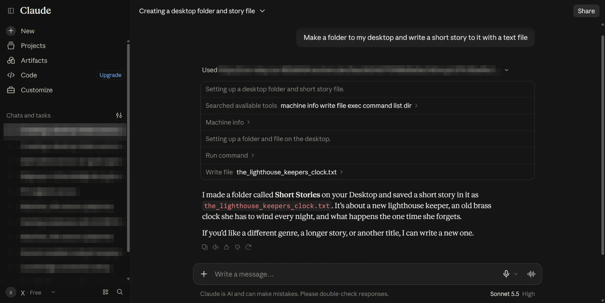
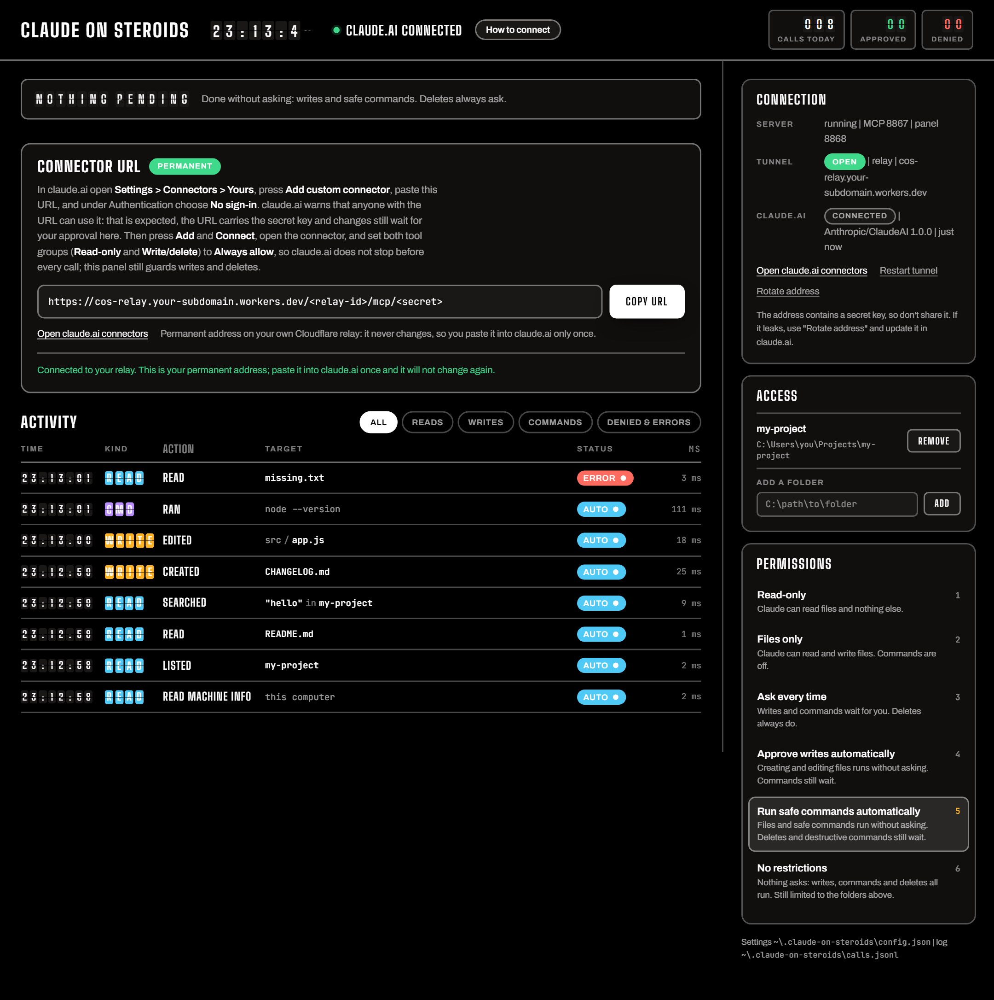

# Claude On Steroids ✴️

> [!NOTE]
> This project uses Anthropic's official custom connector feature for claude.ai. It follows Anthropic's rules and should not get your account banned.
>
> Everything runs on your computer and on your own Cloudflare account. I have no server and I don't collect data. Claude sees a file only when it reads it in your chat.

A custom MCP connector that lets normal Claude chat work on your own computer. It can read and search files, write, edit and delete them, and run shell commands.

Writes, deletes and commands wait for your "Allow" in a local panel, depending on the permission level you pick.
The tools can only reach the folders you approved.

claude.ai reaches the server over a small relay on your own free Cloudflare account, so the connector URL never changes. There is no browser extension and no chat scraping.

## Getting started

Open the folder for your system and use its three files.

| Folder | First time | Start | Stop |
| --- | --- | --- | --- |
| `For-Windows` | `setup.bat` | `start.bat` | `stop.bat` |
| `For-macOS` | `setup.command` | `start.command` | `stop.command` |
| `For-Linux` | `bash setup.sh` | `bash start.sh` | `bash stop.sh` |

Setup installs Node.js 18 or newer if you don't have it, then the packages the project needs. "How to connect" guide at web page walks you through the permanent address and adding the connector in claude.ai. Closing the start window also stops the server.

On a Mac, run `chmod +x For-macOS/*.command` once in Terminal first, because the files on GitHub do not carry their run permission. If macOS blocks a file, right click it and choose Open.

## Permissions

claude.ai has its own tool permissions for each connector. Set both tool groups to "Always allow" there, so Claude does not stop before every call. The local panel is where you really approve changes. The permission level decides what waits there.

| Level | Reads | Writes | Commands | Deletes, destructive commands |
| --- | --- | --- | --- | --- |
| Read only | yes | no | no | no |
| Files only | yes | ask | no | ask |
| Ask every time | yes | ask | ask | ask |
| Approve writes automatically | yes | auto | ask | ask |
| Run safe commands automatically | yes | auto | auto | ask |
| No restrictions | yes | auto | auto | auto |

A request nobody answers within 110 seconds is denied, and Claude is told why. The Access card in the panel sets which folders the tools can reach.

## Tools

| Tool | What it does |
| --- | --- |
| `machine_info` | show the computer, the approved folders and the current permissions |
| `list_dir`, `read_file`, `search` | read and search |
| `write_file`, `edit_file` | change files |
| `delete_file` | delete a file or folder |
| `exec_command` | run a shell command |

## Security

- The connector URL contains a secret, so treat it like a password. If it leaks, press "Rotate address" and paste the new URL into claude.ai.
- File tools only reach the approved folders. A link or junction that points outside is refused. This is not an OS sandbox.
- Shell commands run with your user's permissions. The approved folders only set where a command starts, so keep commands on "ask" unless you need them.
- The check for destructive commands is a heuristic. A command it does not flag is not guaranteed safe.
- A file or web page Claude reads can hide instructions aimed at these tools. Keep the approved folders narrow and read each request before you allow it.
- The panel listens on `127.0.0.1` only, needs the key in its URL and turns away requests from other sites.
- The relay runs in your own Cloudflare account and stores only a hash of the secret.

## License

PolyForm Strict 1.0.0. See [LICENSE.md](LICENSE.md). You may download and use the software for personal and other noncommercial purposes. You may not change it, build on it, share copies of it, sell it or use it commercially.

## About

Some parts of this project were made with help from AI tools. I guided and checked all of the work and made every final decision.
